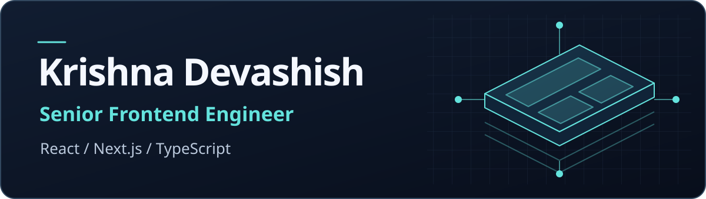

  
   
   
  
  
  

I’m a **Senior Frontend Engineer with 8+ years of experience** building web products. I work across the architecture and the interface, from deciding how teams share components to tuning how a page loads and responds.

## Engineering focus

| Area | What I build |
| :--- | :--- |
| **Frontend architecture** | React and Next.js applications, micro frontends, and boundaries that let teams release independently. |
| **Design systems** | Reusable components with predictable APIs, keyboard support, and accessible interaction patterns. |
| **Web performance** | Responsive interfaces with careful attention to bundle size, loading behavior, and rendering. |
| **Real-time and AI interfaces** | Dashboards that update as events arrive and product workflows that incorporate AI. |

## Selected work

### [Engineering portfolio](https://www.krishnadevashish.com/)

A Next.js site for exploring my engineering experience and project case studies. It pairs a mostly server-rendered experience with interactive features, including an assistant that answers questions about my work.

`Next.js` · `TypeScript` · `Tailwind CSS`

[Explore the portfolio](https://www.krishnadevashish.com/) · [View source](https://github.com/KrishnaDs007/krishnas_portfolio)

<!-- Add a new project heading here when it becomes public. Include what it does, the engineering problem it addresses, and links to the source and demo. -->

## Currently exploring

- **AI agents** — Designing product workflows and evaluating how reliably agents carry them out.
- **Full-stack system design** — Extending frontend architecture into APIs and data modeling with Node.js and PostgreSQL.
